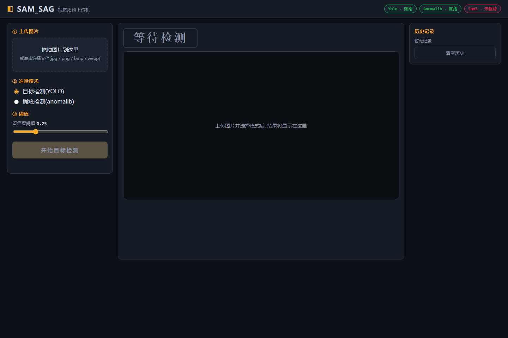
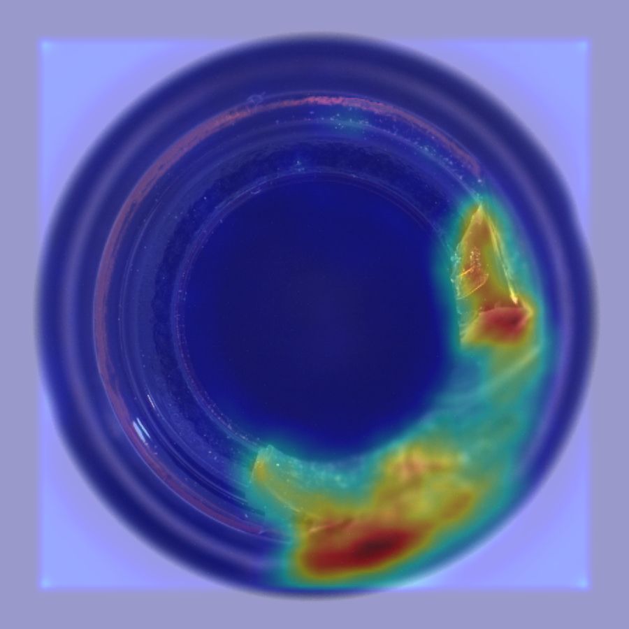
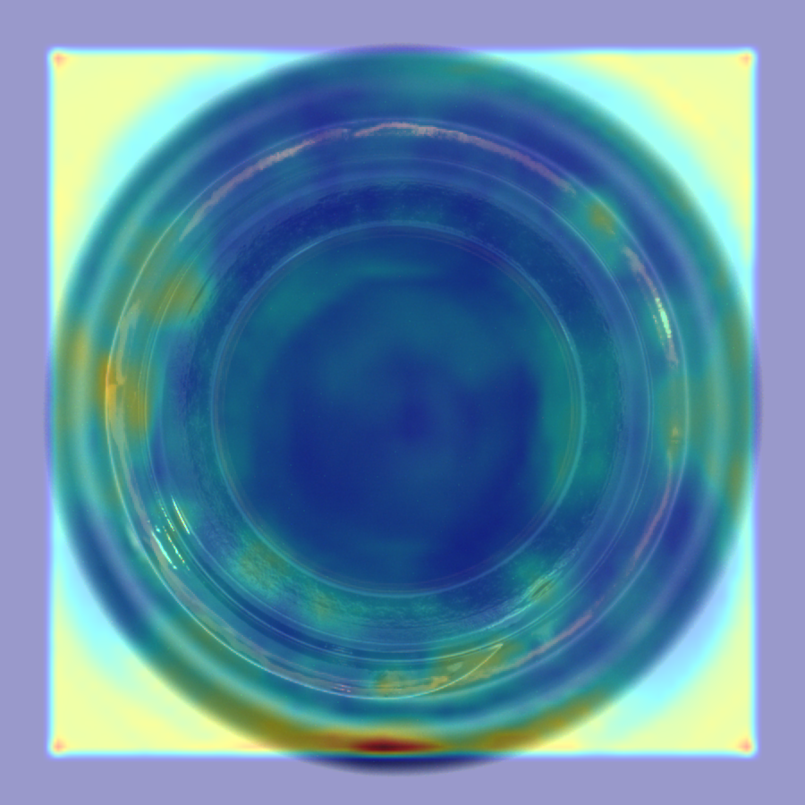
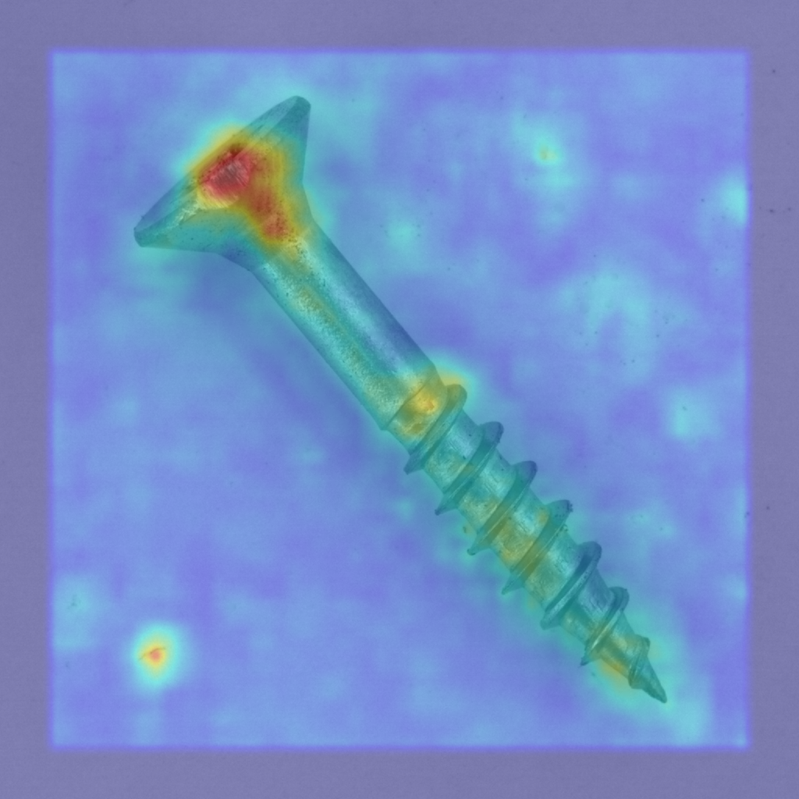
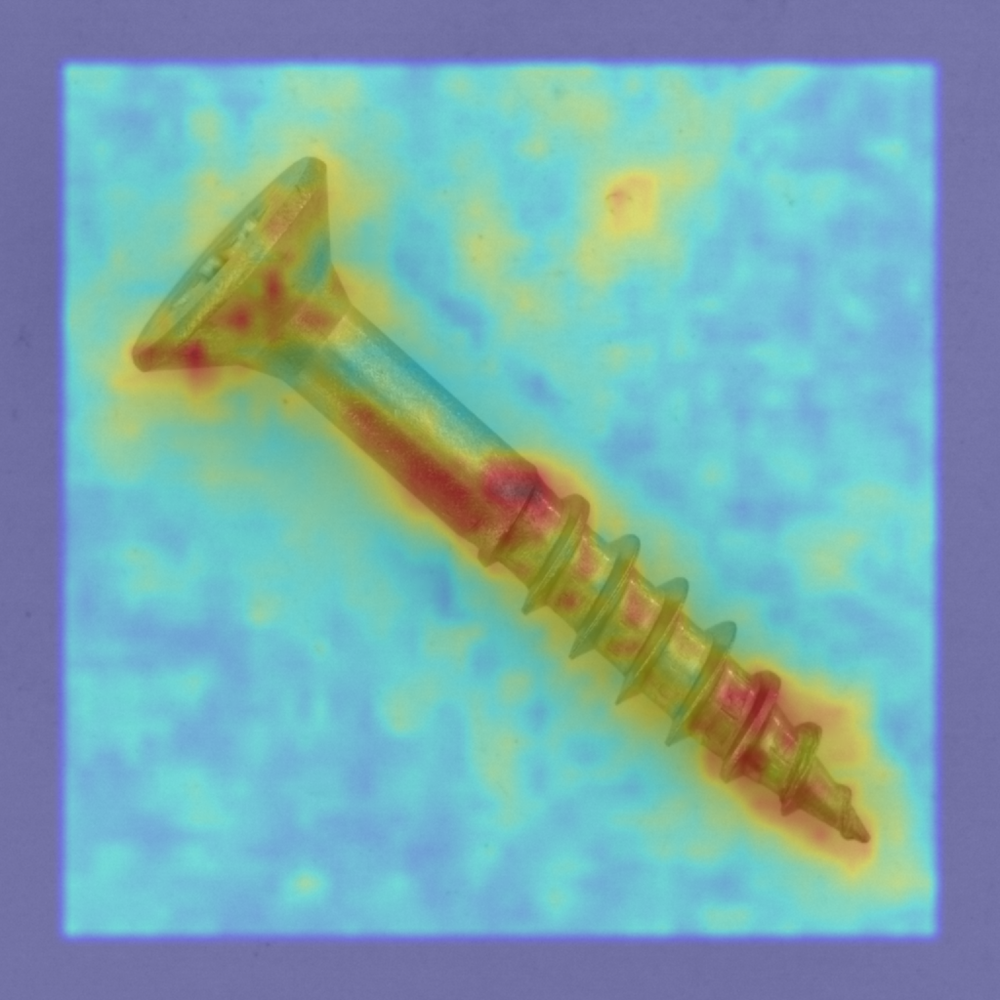

# SAM_SAG — 视觉质检上位机

[](LICENSE)
[](https://www.python.org/)

SAM_SAG 是一套开箱即用的工业视觉质检上位机:上传一张图片,即可完成

- **目标检测** —— 基于 [Ultralytics YOLO](https://github.com/ultralytics/ultralytics),画框 + 标签 + 置信度;
- **无监督瑕疵检测** —— 基于 [anomalib](https://github.com/open-edge-platform/anomalib),输出异常分数、缺陷热力图叠加与 **OK/NG** 判定;
- **SAM3 文本分割(预留插件)** —— 已预留 `weights/sam3/` 接口与调用签名,检测到模型文件后自动开放。

前端为纯原生 HTML/JS 单页(无任何 CDN 依赖,离线可用),后端为 FastAPI,支持一键启动与后台训练任务。

> 仓库地址: <https://github.com/ccccty/SAM_SAG>

---

## 功能截图



瑕疵检测效果对比(EfficientAD,左 NG / 右 OK):

| bottle 异常 | bottle 正常 |
| --- | --- |
|  |  |

| screw 异常 | screw 正常 |
| --- | --- |
|  |  |

异常热力图见 `docs/screenshots/` 下各 `*_heatmap.png`。

## 实测指标

硬件: **NVIDIA RTX 3060 Ti**(8 GB 显存); 数据集: **MVTec AD**; 瑕疵检测模型: **EfficientAD**。
**当前已训练类别: `bottle`, `screw`**(其余 MVTec 类别可用 `training/train_anomalib.py` 自行训练)。

| 类别 | image_AUROC | image_F1 | pixel_AUROC |
| --- | --- | --- | --- |
| bottle | 1.000 | 0.992 | 0.976 |
| screw | 0.962 | 0.945 | 0.982 |

| 推理链路 | 单图耗时(RTX 3060 Ti) |
| --- | --- |
| YOLO 目标检测(`/api/detect`) | ~48 ms |
| anomalib 瑕疵检测(`/api/inspect`) | ~400–570 ms |

## 快速开始

### 环境要求

- Windows 10/11(Linux/macOS 同样适用)
- Python **3.11+**
- NVIDIA GPU + CUDA 可选(无 GPU 时自动回落 CPU,速度变慢但功能完整)

### 安装

```bat
git clone https://github.com/ccccty/SAM_SAG.git
cd SAM_SAG

python -m venv .venv
.venv\Scripts\activate

:: 1) 安装 PyTorch:有 N 卡推荐 CUDA 12.1 版本
pip install torch torchvision --index-url https://download.pytorch.org/whl/cu121
::    无 N 卡则用 CPU 版:
::    pip install torch torchvision

:: 2) 安装其余依赖
pip install -r requirements.txt

:: 3) 下载 YOLO 权重 + 查看数据集/模型放置指引
python scripts\download_assets.py --yolo
```

### 启动

```
start.bat
```

或手动:

```
python -m backend.main
```

浏览器自动打开 <http://127.0.0.1:8000> 。

> **优雅降级**: 权重文件缺失时服务照常启动,对应接口返回 `503` 并在页面提示"模型未就绪",不会崩溃。

## 模型与数据

| 内容 | 放置路径 | 获取方式 |
| --- | --- | --- |
| YOLO 检测权重 | `weights/yolo11n.pt` | `python scripts/download_assets.py --yolo` 自动下载 |
| anomalib 瑕疵模型 | `weights/anomalib/<类别>/*.ckpt` | 用 `training/train_anomalib.py` 自行训练(见下) |
| SAM3 权重(可选) | `weights/sam3/` | 待 SAM3 官方发布后按 `weights/README.md` 放置 |
| MVTec AD 数据集 | `data/mvtec/<类别>/{train,test}/` | 官方申请(见 `scripts/download_assets.py --mvtec` 指引) |

### 训练自己的瑕疵检测模型

```bat
:: 校验数据集目录
python training\prepare_dataset.py --category bottle

:: 在 data\mvtec\bottle 上训练 EfficientAD(默认 256 尺寸, 适配 8GB 显存)
python training\train_anomalib.py --category bottle --model efficientad --epochs 50

:: 产物自动写入 weights\anomalib\bottle\*.ckpt, 重启服务后即可在页面选择该类别
```

### 微调 YOLO

```bat
python training\train_yolo.py --data path\to\dataset.yaml --epochs 100 --imgsz 640 --batch 8
:: best.pt 会复制到 weights\yolo11n.pt 作为线上服务权重(可用 --deploy-name 改名)
```

### 冒烟测试

```bat
python scripts\smoke_test.py
```

## 目录结构

```
SAM_SAG/
├── backend/            # FastAPI 后端
│   ├── main.py         #   应用入口: 静态前端挂载 / CORS / 统一错误格式
│   ├── api/routes.py   #   /api/health /api/models /api/detect /api/inspect /api/train
│   └── core/           #   配置 + YOLO 封装 + anomalib 封装 + SAM3 插件
├── frontend/           # 原生 JS 单页(离线可用, 无 CDN)
├── training/           # anomalib / YOLO 训练与数据集整理脚本
├── scripts/            # 下载引导 + 冒烟测试
├── docs/               # GitHub Pages 展示站(纯静态)
├── weights/            # 模型权重(不入库, 见 weights/README.md)
├── data/               # 数据集(不入库)
└── runs/               # 训练产物(不入库)
```

## API 一览

| 方法 | 路径 | 说明 |
| --- | --- | --- |
| GET | `/api/health` | 服务健康检查 |
| GET | `/api/models` | 各引擎可用状态(YOLO / anomalib 各类别 / SAM3) |
| POST | `/api/detect` | 上传图片 → YOLO 检测框 |
| POST | `/api/inspect` | 上传图片 + `category` → 异常分数 / 热力图 / OK/NG |
| POST | `/api/train` | 启动后台训练任务 |
| GET | `/api/train/{task_id}` | 查询训练任务状态 |

统一错误格式: `{"ok": false, "error": {"code": "...", "message": "..."}}` 。

## 致谢

本项目站在这些优秀开源项目的肩膀上:

- [anomalib](https://github.com/open-edge-platform/anomalib) —— 无监督异常检测算法库(EfficientAD / PatchCore 等)
- [Ultralytics YOLO](https://github.com/ultralytics/ultralytics) —— 目标检测训练与推理
- [SAM3 (Segment Anything 3)](https://github.com/facebookresearch/segment-anything) —— 文本提示分割(预留接口)

## License

[MIT](LICENSE)
